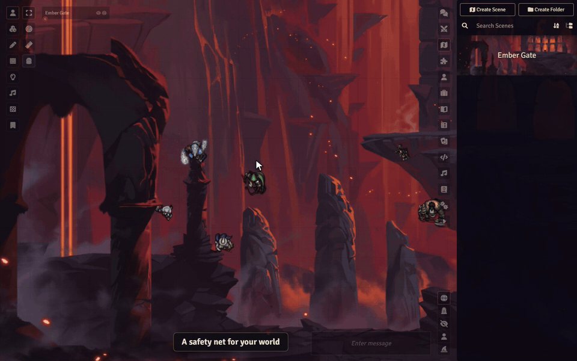

# Sephral’s Content Backup & Restore

**Deleted the wrong actor? Broke a scene you spent hours on? Get it back in seconds.** Content Backup & Restore keeps named backups of your world's content and restores them whenever you need, even after a document was deleted.

## Highlights

* **One right click away:** save a named backup of a scene, actor, item, journal entry, playlist, macro, roll table or card stack straight from the sidebar.
* **Restore without regrets:** before every restore the current state is saved as a backup too. Changed your mind? Restore that one.
* **Bring back what you deleted:** the recovery view lists deleted documents that still have a backup. They return with their original ID, so links, linked tokens and combat entries work again.
* **No surprises after updates:** every backup remembers the Foundry and game system version it was made with, and the restore warns you when your world has moved on.
* **All backups in one window:** browse, restore, delete and recover everything from one central manager.
* **Automate your safety net:** a short macro backs up every scene before each session. The manual has the example.
* **Works on The Forge:** backups go to your Assets Library automatically.

## How it works

1. Right click a document in the sidebar and choose **Sephral’s Content Backup & Restore**.
2. Name the backup and save it.
3. Need it back? Open the same menu to restore it, or open the manager from the module settings to recover deleted documents.

## Install

Search for **Content Backup & Restore** in Foundry's module browser or open the [package page](https://foundryvtt.com/packages/sephrals-content-backup-restore).

Foundry VTT 13 and 14 · any game system · English and German

## Learn more

The [manual](MANUAL.md) covers the settings, the macro API with examples and where backups are stored, also on The Forge.

Questions or ideas? Join us on [Discord](https://discord.gg/7BjCgDYaBP). Looking for more? See [all modules by Sephral](https://github.com/Sephral).

## License

See [LICENSE.md](LICENSE.md).
